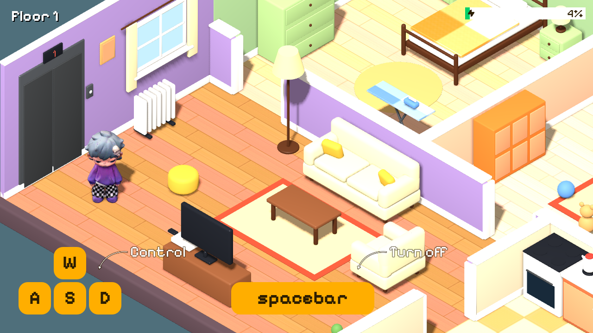

# Енергетична криза

Ізометрична 3D-гра про економію електроенергії. Прилади в квартирі вмикаються самі, а ви бігаєте кімнатами й вимикаєте їх, поки не вибило пробки. 10 поверхів, на кожному своя квартира, а після десятого гра триває без кінця.

### ▶ [Грати в браузері](https://olprmk.github.io/energy-crisis/)

Гра працює на комп'ютері й на телефоні, вертикально й горизонтально (на телефоні з'являються аналоговий стік і кнопка вимикання). Перше завантаження займає кілька секунд: гра важить близько 60 МБ.

Це версія 1: інтерфейс англійською, грати можна дитиною. Інші персонажі вже є в коді й з'являться в наступних оновленнях.

## Як грати

- Натисніть **Start**. Після відліку 3, 2, 1 починається раунд на поверсі: 60 секунд.
- Увімкнений прилад блимає, над ним «!», а на підлозі кільце, де треба стати. Підійдіть і вимкніть його пробілом.
- Шкала вгорі праворуч показує навантаження мережі. Якщо воно довго тримається вище ліміту, вибиває пробки.
- Щоб піднятися на наступний поверх, наприкінці хвилини все має бути вимкнено, а економія не нижча за поріг. Холодильник вимикати не можна.
- Після поверху видно спожиту енергію, економію й зірки (1–3). Далі **Next floor** або **Restart game** (з першого поверху).
- Гра пам'ятає, на якому поверсі ви зупинилися, і наступного разу продовжує з нього.
- Новому гравцеві на першому поверсі (і щодня при першій грі) показано підказку з клавішами; вона зникає після першого вимкненого приладу.

| Дія | Клавіатура | Телефон |
|---|---|---|
| Рух | WASD або стрілки | стік (що далі відвести, то швидше) |
| Вимкнути прилад | Пробіл | кнопка зі знаком живлення |
| Start, Next floor | Enter або Пробіл | кнопка на екрані |
| Restart game (на стартовому екрані й після поверху) | R | кнопка на екрані |
| Перезапустити поверх (під час гри) | R | — |
| На стартовий екран | Esc | — |
| Музика | M | — |
| Лічильник кадрів | F3 | — |

## Запуск з коду

Потрібен [Godot 4.7](https://godotengine.org) (звичайна версія, не .NET). Відкрийте `game/project.godot` і натисніть F5.

Веб-версію збирає пресет **Web** (`game/export_presets.cfg`, без потоків, щоб працювало на GitHub Pages): *Project → Export → Web*. Зібрана гра лежить у гілці [`gh-pages`](../../tree/gh-pages).

Докладний опис гри, налаштувань і балансу — у [game/README.md](game/README.md). Скрипти Blender і вихідні файли моделей та музики в цей репозиторій не входять.
