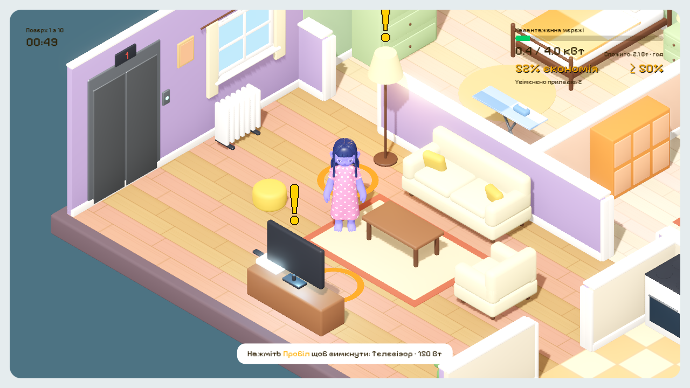

# Енергетична криза

Ізометрична 3D-гра про економію електроенергії. Прилади в квартирі вмикаються самі, а ви бігаєте кімнатами й вимикаєте їх, поки не вибило пробки. 10 поверхів, на кожному своя квартира, 4 персонажі.

### ▶ [Грати в браузері](https://olprmk.github.io/energy-crisis/)

Гра працює на комп'ютері й на телефоні (на телефоні з'являються сенсорні кнопки). Перше завантаження займає кілька секунд: гра важить близько 60 МБ.

## Як грати

- Введіть ім'я, оберіть персонажа: Джоан, Рекс, Алекс або Ніка. У кожного своя швидкість і час вимикання.
- Раунд на поверсі триває 60 секунд. Увімкнений прилад блимає, над ним «!», а на підлозі кільце, де треба стати.
- Підійдіть і вимкніть прилад. Якщо навантаження довго тримається вище ліміту, вибиває пробки.
- Щоб піднятися на наступний поверх, наприкінці хвилини все має бути вимкнено, а економія не нижча за поріг. Холодильник вимикати не можна.

| Дія | Клавіатура | Телефон |
|---|---|---|
| Рух | WASD або стрілки | хрестовина |
| Вимкнути прилад, почати, далі | Пробіл або Enter | кнопка **0** |
| Назад до вибору персонажа | Esc | кнопка **X** |
| Перезапустити поверх | R | — |
| Музика | M | — |

## Запуск з коду

Потрібен [Godot 4.7](https://godotengine.org) (звичайна версія, не .NET). Відкрийте `game/project.godot` і натисніть F5.

Веб-версію збирає пресет **Web** (`game/export_presets.cfg`, без потоків, щоб працювало на GitHub Pages): *Project → Export → Web*. Зібрана гра лежить у гілці [`gh-pages`](../../tree/gh-pages).

Докладний опис гри, налаштувань і балансу — у [game/README.md](game/README.md). Скрипти Blender і вихідні файли моделей та музики в цей репозиторій не входять.
